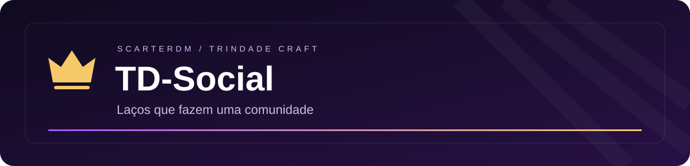

<b>Igreja, devoção, moral e relacionamentos.</b> Um projeto de <a href="https://github.com/ScarterDM">ScarterDM</a>, exclusivo para a <b>Trindade Craft</b>.

  

## Sobre o projeto

TD-Social faz parte de uma família de plugins criada para atender às necessidades do próprio servidor Trindade Craft. Sua proposta é **igreja, devoção, moral e relacionamentos**, mantendo a integração com os demais sistemas da comunidade.

## O que o projeto reúne

### Vida religiosa

- Deuses, altares, oração, confissão, penitências e oferendas.
- Missas, participação, bênçãos e funções do clero.
- Moral e devoção disponibilizadas a integrações compatíveis.

### Relacionamentos

- Namoro, renovação, noivado, casamento e divórcio.
- Pedidos, cerimônias, registros e certidões.
- Informações sociais do jogador e estrutura para evolução familiar.

## Navegação no servidor

Os comandos disponíveis dependem dos módulos habilitados e das permissões do jogador.

- `/social` — Vida religiosa, famílias e clãs Atalhos: `/tdsocial`, `/igreja`, `/devocao`, `/padre`, `/familia`, `/família`, `/cla`, `/bispo`.
- `/aceitar` — Aceita um pedido de relacionamento vigente
- `/bolo` — Felicita o aniversariante anunciado
- `/uhu` — Felicita o último casal anunciado
- `/bencao` — Pede a bênção a um padre próximo Atalhos: `/benção`, `/bênção`.
- `/orar` — Inicia uma oração em área válida

## Evolução e compatibilidade

O projeto está em evolução. A disponibilidade de cada recurso depende da versão aprovada para o servidor. Recursos visuais, menus e integrações podem variar conforme a versão do Minecraft, o cliente Java/Bedrock e os plugins associados. Esta apresentação não substitui a validação da versão instalada.

As atualizações em desenvolvimento são identificadas como **DEV**. Uma versão só recebe o estado **OFICIAL** após a aprovação de ScarterDM para uso na Trindade Craft.

## Exclusividade e orçamento

**Plugin exclusivo da Trindade Craft.** Este repositório é uma apresentação pública: o código-fonte, os arquivos de configuração do servidor e os executáveis não são distribuídos aqui.

Interessados em uma solução personalizada devem procurar **ScarterDM**, pelos canais oficiais da Trindade Craft, para avaliação do projeto e **orçamento personalizado**.

## Autoria

Desenvolvido por **ScarterDM** para a **Trindade Craft**. Software proprietário. A publicação desta apresentação não concede licença de uso, distribuição ou reprodução do plugin.

---

[Conheça os outros projetos da família TD](https://github.com/ScarterDM#família-td)
